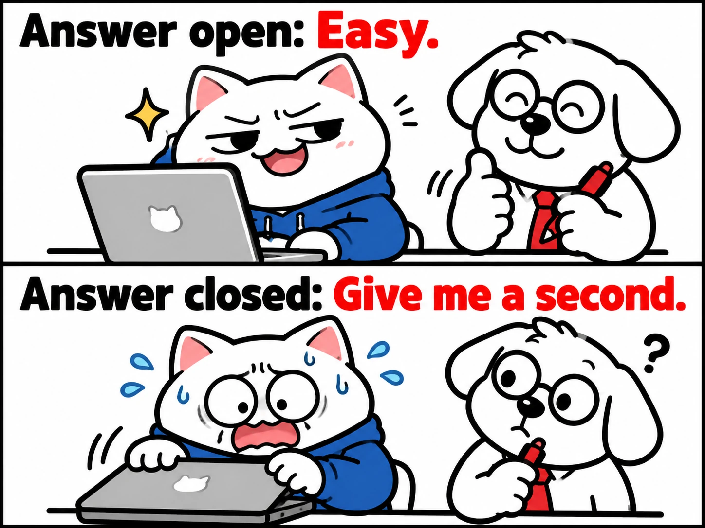
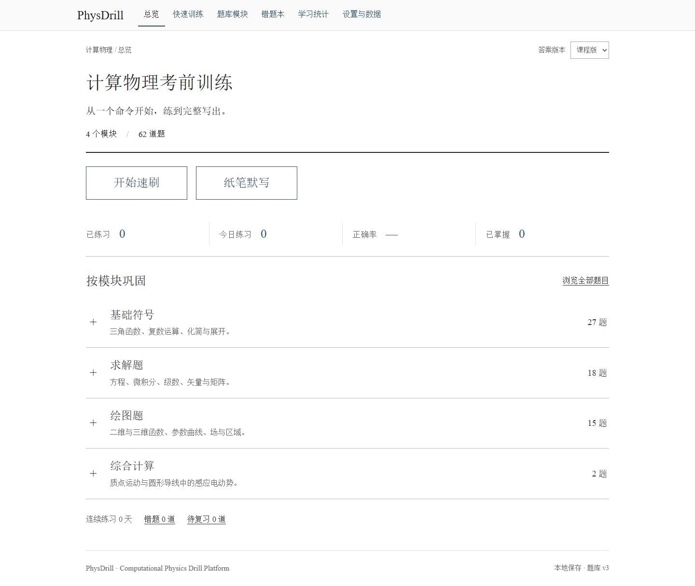
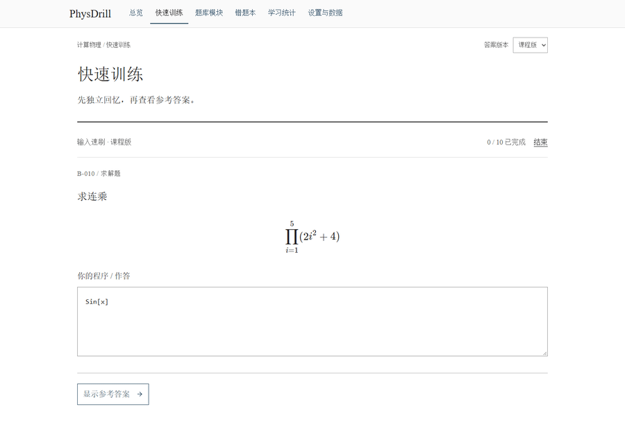
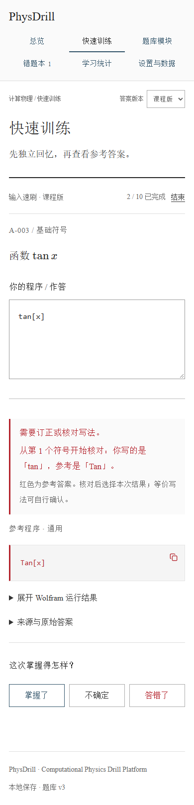
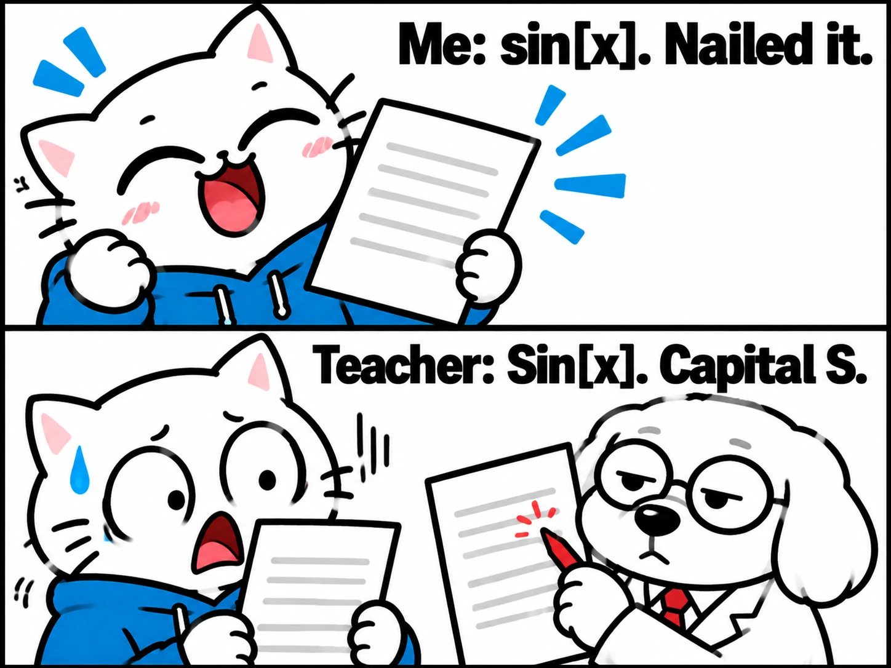
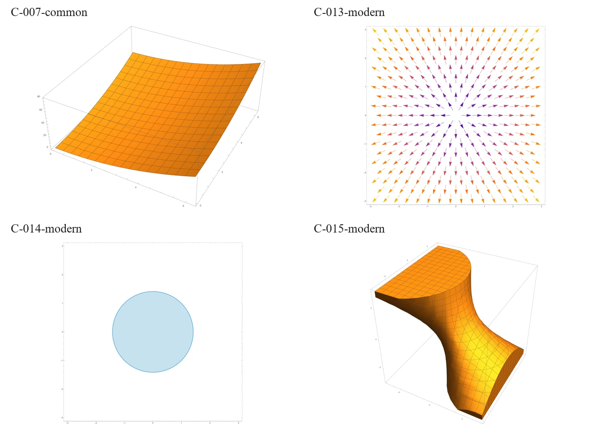
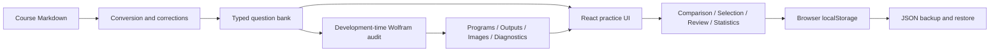

# PhysDrill

**Computational Physics Drill Platform** · [Try online](https://hnnuyuxuan.github.io/PhysDrill/) · [简体中文](README.md)



A local-first practice application for handwritten computational physics exams. Recall a command, write it, reveal the reference, assess your understanding, and repeat. The interface and course questions are in Chinese.



## Practice online

**[Open PhysDrill →](https://hnnuyuxuan.github.io/PhysDrill/)**

Use it directly on desktop or mobile without installing anything. Each browser stores its own progress. Transfer records between devices or from localhost through JSON backup export/import in Settings.

The interface follows the academic reading style of [General Physics Lab](https://hnnuyuxuan.github.io/general-physics-lab/simulations/): white paper, serif typography, top navigation, and expandable module directories.

## Run locally

Requires Node.js 24 and npm.

```sh
npm ci
npm run dev
```

Open [PhysDrill locally](http://127.0.0.1:5173/PhysDrill/). No account, backend, or Mathematica installation is required. Dependency installation needs network access; the application uses no external runtime API.

```sh
npm test
npm run typecheck
npm run lint
npm run build
npm run preview
```

Development and preview use the same fixed address and port. Stop the other server first; an occupied port causes startup to fail. Build output is in `dist/`, suitable for a static HTTP server.

## Practice workflow



The animation shows writing, correction, passing, and review. Production details are in the asset notes linked below.

- 62 source questions: 27 symbolic operations, 18 solving, 15 plotting, 2 calculations.
- Immediate reference matching: matching input is recorded as correct and advances by default; differences point to the first token to check.
- Red reference programs come first. Derivations, verification notes, and Wolfram graphics expand on demand.
- Typed practice, paper recall without typing, and deterministic syntax exercises.
- Category, command tag, wrong, unseen, and due filters; random or source order; 10/20/50/custom/unlimited sessions.
- Wrong and uncertain attempts enter the wrong book. Correct answers and manual removal preserve historical errors.
- Drafts, current question, revealed state, and progress survive refresh.
- Statistics derive from actual completed assessments. Syntax exercises have separate records and do not establish full-question mastery.



## Answers and checking



The course originals are in [questions.md](sources/questions.md) and [notes.md](sources/notes.md), with their contents and hashes preserved. Corrected answers retain their provenance and originals. Real/imaginary parts, series term counts, real-valued fractional powers, and induced emf have documented corrections. See [verification notes](docs/verification.md).

Course mode retains historical API conventions; modern mode uses current built-in commands. Course mode is the default. Different answer variants have separate progress, identical answers share it, and active sessions retain their selected version.

Matching input is recorded as correct. Differences reveal correction hints for learner review. Automatic checking compares lexical program structure; equivalent forms and multi-step calculations use learner self-assessment. Normalized checking preserves case, brackets, operators, argument order, and symbol boundaries. Strict mode also preserves internal whitespace. Interpretation notes accompany ambiguous source wording.

## Wrong-book review


Three consecutive confident answers establish mastery. Review intervals are 1, 3, 7, and 14 days. Wrong answers are due today; uncertain answers tomorrow. Random rounds avoid repetition until the pool is exhausted and prioritize weaker questions.

## Reproducible Wolfram evidence

The 62 questions have **71 published `.wl` programs**, each executed in a fresh Wolfram 15.0.1 kernel. All 62 common/modern programs completed without diagnostic messages, including exported images for all 15 plotting questions. Nine course variants retain missing-package diagnostics; two still produce plots through built-in commands. Six additional mathematical tests cover key corrections.

[Wolfram sources and runner](wolfram/) · [Full execution record](public/wolfram/audit.json) · [Method and records](docs/verification.md)



Expand the Wolfram section under an answer to inspect its image and output. The handwritten program remains the learning priority. Reproducing the audit requires your own licensed Wolfram installation; everyday web practice does not.

```sh
node scripts/wolfram-files.mjs
wolframscript -file wolfram/RunAll.wls
wolframscript -file wolfram/TestCorrections.wls
```

## Data and architecture

Settings exports either the question bank or a complete JSON backup. Imports are validated and previewed before replacement. Full backups contain questions, history, preferences, and session state. Resetting practice keeps the bank and preferences.

Data lives under `physdrill.v1` in browser `localStorage`, scoped to the exact origin. Different browsers, hostnames, and ports do not share records. Clearing browser data deletes them; export backups regularly. Storage errors expose recovery/export actions.



Run `npm run bank` after changing conversion rules or corrections, then run tests. Preserve stable question IDs and increment revisions for substantive answer changes. Questions are maintained from the course originals and traced by stable IDs. Bank v3 uses English source paths; loading older records and backups migrates matching source hashes while retaining drafts and progress.

## Validation and runtime requirements

Automated tests cover the bank, formula rendering, program comparison, review scheduling, backup migration, and published Wolfram files. GitHub Actions runs formatting, type checks, tests, and production builds. `scripts/browser-marking.cjs` uses the fixed Playwright Chromium runtime for desktop and mobile interaction checks.

Maintainers run the Wolfram audit locally; the web application displays precomputed results. Legacy plotting-package requirements, kernel diagnostics, and mathematical assumptions are documented in the [verification record](docs/verification.md).

## Deployment

Pushes to main run tests and build, then publish `dist/` through GitHub Actions to GitHub Pages. The project base path is `/PhysDrill/`; formula fonts and icons ship with the build. See `.github/workflows/pages.yml`.

## A small portfolio project

Built from a personal exam-preparation need, PhysDrill connects source conversion, answer versions, quick feedback, review scheduling, and reproducible verification in a lightweight tool. Use the [project case note](docs/portfolio.md), screenshots, and live link in a portfolio. The visual language uses black and white for reading, red for marking, and blue for supporting notes.

See [asset provenance](docs/assets/README.md).
