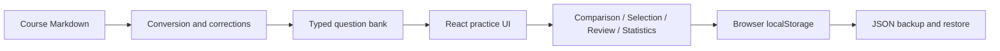

# PhysDrill

**Computational Physics Drill Platform** · [简体中文](README.md)

A local-first practice application for handwritten computational physics exams. Recall a command, write it, reveal the reference, assess your understanding, and repeat. The interface and course questions are in Chinese.


## Practice online

**[Open PhysDrill →](https://hnnuyuxuan.github.io/PhysDrill/)**

Use it directly on desktop or mobile without installing anything. Each browser stores its own progress. Transfer records between devices or from localhost through JSON backup export/import in Settings.

The interface follows the academic reading style of [General Physics Lab](https://hnnuyuxuan.github.io/general-physics-lab/simulations/): white paper, serif typography, top navigation, and expandable module directories.

## Run locally

Requires Node.js 24 and npm.

```sh
npm ci
npm run dev
```

Open [PhysDrill locally](http://127.0.0.1:5173/PhysDrill/). No account, backend, or Mathematica installation is required. Dependency installation needs network access; the application uses no external runtime API.

```sh
npm test
npm run typecheck
npm run lint
npm run build
npm run preview
```

Development and preview use the same fixed address and port. Stop the other server first; an occupied port causes startup to fail. Build output is in `dist/`, suitable for a static HTTP server.

## Practice workflow


The animation uses actual browser screenshots with a two-second hold per frame; playback timing is illustrative.

- 62 source questions: 27 symbolic operations, 18 solving, 15 plotting, 2 calculations.
- Typed practice, paper recall without typing, and deterministic syntax exercises.
- Category, command tag, wrong, unseen, and due filters; random or source order; 10/20/50/custom/unlimited sessions.
- Wrong and uncertain attempts enter the wrong book. Correct answers and manual removal preserve historical errors.
- Drafts, current question, revealed state, and progress survive refresh.
- Statistics derive from actual completed assessments. Syntax exercises have separate records and do not establish full-question mastery.


## Answers and checking

The original Markdown files remain unchanged. Corrected answers retain their provenance and originals. Real/imaginary parts, series term counts, real-valued fractional powers, and induced emf have documented corrections. See [verification notes](docs/verification.md).

Course mode retains historical API conventions; modern mode uses current built-in commands. Course mode is the default. Different answer variants have separate progress, identical answers share it, and active sessions retain their selected version.

Comparison reports reference-text matches or differences, not general mathematical equivalence. Normalized checking preserves case, brackets, operators, argument order, and symbol boundaries. Strict mode also preserves internal whitespace. Multi-step calculations use self-assessment. Interpretation notes accompany ambiguous source wording.

Three consecutive confident answers establish mastery. Review intervals are 1, 3, 7, and 14 days. Wrong answers are due today; uncertain answers tomorrow. Random rounds avoid repetition until the pool is exhausted and prioritize weaker questions.

## Data and architecture

Settings exports either the question bank or a complete JSON backup. Imports are validated and previewed before replacement. Full backups contain questions, history, preferences, and session state. Resetting practice keeps the bank and preferences.

Data lives under `physdrill.v1` in browser `localStorage`, scoped to the exact origin. Different browsers, hostnames, and ports do not share records. Clearing browser data deletes them; export backups regularly. Storage errors expose recovery/export actions.



Run `npm run bank` after changing conversion rules or corrections, then run tests. Preserve stable question IDs and increment revisions for substantive answer changes. Content remains limited to supplied course material.

## Validation and limitations

Core tests, formula rendering, type checks, builds, and GitHub Actions are included. `scripts/browser-check.cjs` drives actual browser checks through an existing fixed Playwright CLI installation; this runtime is not an application dependency.

The available Wolfram kernel lacks several legacy packages and reports internal diagnostics for some modern plotting operations. These are recorded separately from syntax validation. Successful parsing is not proof of full mathematical or graphical correctness. The browser does not execute Mathematica code.

## Deployment

Pushes to main run tests and build, then publish `dist/` through GitHub Actions to GitHub Pages. The project base path is `/PhysDrill/`; formula fonts and icons ship with the build. See `.github/workflows/pages.yml`.
