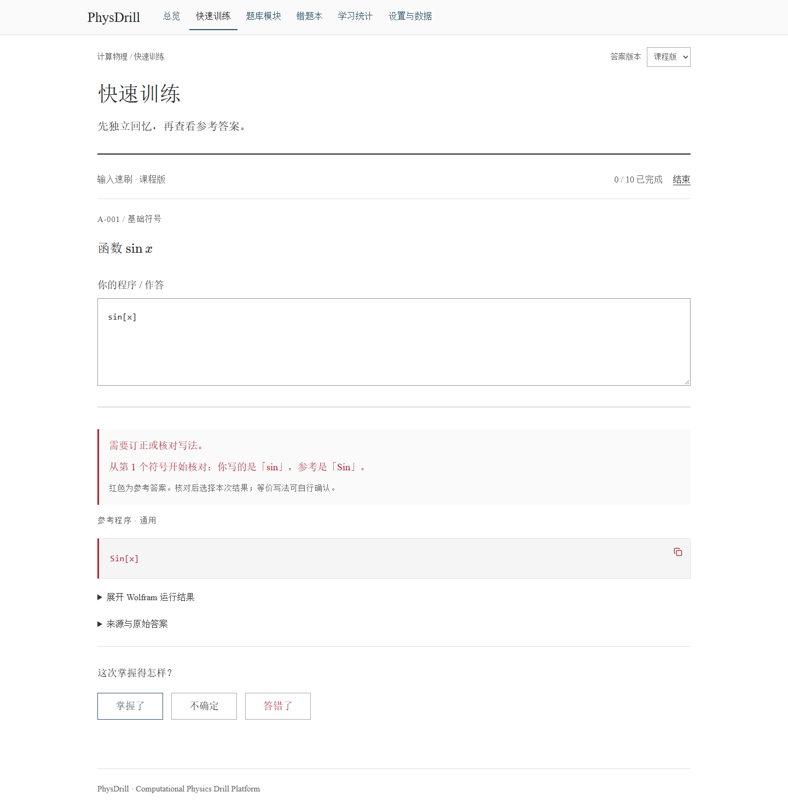

# PhysDrill · 项目介绍

[在线体验](https://physdrill.yuxuan.wiki) · [源码](https://github.com/HNNUYUXUAN/PhysDrill)

## 一句话

面向计算物理纸笔考试的轻量训练工具：把课程复习资料变成可重复练习、即时订正、可追溯核验的本地学习空间。

## 需求与设计

考前复习的主要困难是快速回忆完整程序，并减少大小写、括号、参数和等号的书写错误。PhysDrill 将 62 道课程题整理为结构化题库，把连续练习和参考答案放在界面中心。

输入与参考程序匹配时自动通过，有差异时指出待核对符号。参考程序使用批阅红；推导、说明和 Wolfram 图形按需展开。纸笔默写无需输入，复杂计算允许自评。

## 实现

- React + TypeScript + Vite；静态网站，适配电脑和手机。
- 本地持久化保存草稿、错题、掌握状态和练习记录，JSON 备份支持设备间手动转移。
- 课程版／现代版答案共存，稳定 ID 与修订号使来源和进度可追溯。
- 简单、可解释的加权抽题和 1／3／7／14 天复习间隔。
- 71 份 Wolfram 源程序、独立内核执行记录、15 道绘图题的导出图形，配套 6 项关键数学测试。

## 作品展示

仓库包含自动测试、浏览器验收记录和可复现核验脚本。学习统计由用户完成的练习计算。

## English case note

**PhysDrill is a local-first study tool for handwritten computational physics exams.** It converts 62 course questions into repeatable drills, with precise reference matching, correction cues, paper recall, and a persistent wrong-answer book.

The design prioritizes the reference program: red answers first, optional derivations and real Wolfram exports second. A static React/TypeScript application serves desktop and mobile browsers. Browser storage keeps progress local, with manual JSON backup transfer.

Engineering evidence includes 71 published Wolfram programs executed in fresh kernels, images for all 15 plotting questions, six targeted mathematical checks, and automated application tests. The project demonstrates a complete path from source material to a usable, verifiable study workflow.
